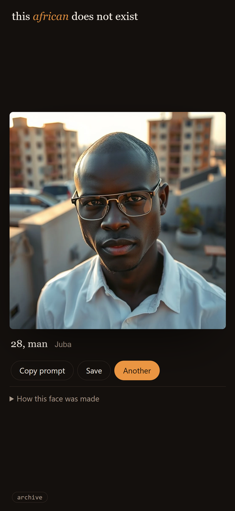

# This African Does Not Exist

There was no **This African Does Not Exist**, till now.



This is a public, open invitation to explore realistic, AI-generated portraits of
modern Africans: one face at a time, with no real person behind the image. If
this idea is useful, interesting, or incomplete, please fork it, clone it,
improve it, and share what you build.

The project is inspired by `thispersondoesnotexist.com`, but it is designed
around African regions, cities, appearances, clothing, hair, lighting, and
everyday photographic details. The goal is not to represent every African
person or culture perfectly. It is to provide a transparent, extensible
starting point for better representation and experimentation.

## Public URL
Try  [thisafricandoesnotexist](https://oswaldamoah.github.io/thisafricandoesnotexist/) today

## The challenge

thisafricandoesnotexist currently does not utilize a model trained specifically for generating african nonexistent (unless it happens to look like someone) personalities

Most image-generation models that produce realistic faces have not been trained
with enough diverse African face data. The consequence is visible: African
faces can be represented less accurately, with limited variation, distorted
features, or imported assumptions about what an African person should look
like. Better prompting can help, but it cannot replace better training data and
better models.

That work still needs to be done. More representative, consented, and
responsibly sourced African face data—and models evaluated against that
diversity—would make this project a better reality. This repository is a small
step toward making the gap visible and inviting people to help close it.

## Try it locally

Requirements: Node.js 20 or newer.

```bash
npm install
copy .env.example .env
npm start
```

Open <http://localhost:3000>. No API keys are required: Pollinations is the
default fallback provider, although generation may be slow.

For an offline pipeline check:

```bash
npm run mock
```

To preview generated prompts without making images:

```bash
npm run test-prompt
```

## How it works

1. `public/phenotypes.json` defines weighted regions, age groups, anatomy,
   skin tones, hairstyles, clothing, cities, expressions, and camera details.
2. `public/promptEngine.js` samples a consistent profile and assembles its
   prompt.
3. Optional language models polish the prompt.
4. An enabled image provider generates the portrait. Providers are rotated,
   rate-limited, and backed off after failures.
5. `lib/image.js` crops provider watermarks, makes a square 1024px WebP, and
   adds an `AI-generated` EXIF description.
6. Images and metadata are stored in a small file-backed pool under `data/`.
7. The server exposes the page and JSON endpoints, or the same assets can be
   published statically to GitHub Pages.

See [DOCUMENTATION.md](./DOCUMENTATION.md) for architecture, configuration,
deployment, and extension details.

## API

| Endpoint | Purpose |
| --- | --- |
| `/` | Web interface |
| `/face.webp` | Random face as an image |
| `/api/face` | Random face and metadata |
| `/api/face/:id` | A specific face |
| `/api/stats` | Pool and provider statistics |
| `/api/sample?seed=123` | Preview a deterministic prompt |

## GitHub Pages mode

The included workflow can generate batches on Kaggle and publish a static site
to GitHub Pages. Configure `KAGGLE_USERNAME` as an Actions variable and
`KAGGLE_API_TOKEN` as an Actions secret, enable GitHub Pages with **GitHub
Actions** as its source, then run the `faces` workflow manually once.

The workflow keeps the newest face pool on a separate `pool` branch so the
main repository does not grow indefinitely. Read the deployment checklist in
[DOCUMENTATION.md](./DOCUMENTATION.md) before enabling it.

## Contributing

Fork the repository, make a focused change, run the relevant local checks, and
open a pull request. Useful contributions include:

- improving phenotype data without stereotyping or flattening regional variety;
- adding or maintaining image and language-model providers;
- improving accessibility, performance, and static hosting;
- adding tests for prompt consistency and image processing;
- documenting provider quotas and deployment changes.

Please do not use generated faces as real identities, fake testimonials,
profiles, IDs, or evidence. The site should always make clear that the people
shown do not exist.

## License

This project is available under the [Apache License 2.0](./LICENSE). You may
use, modify, and redistribute it—including commercially—as long as you keep
the copyright and license notices and mark modified files. This is the
license's way of ensuring the original project receives credit.

Provider APIs, models, and datasets may have separate terms and quotas; check
those terms before deploying a fork.
